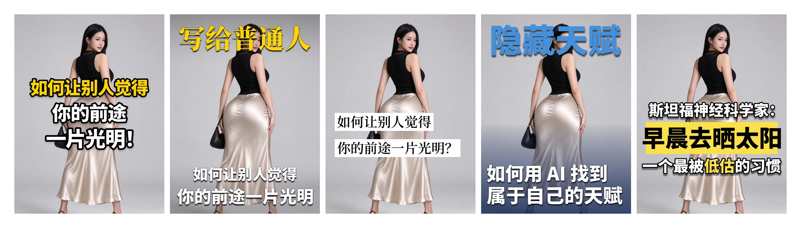

# 风格库 INDEX / Style Library Index

> 这是"活的"总览。每收一张新风格卡就在这里加一行。出图前先读这里选风格。
>
> **编号规则**：`01` 起，**只增不改**。用户说"用第一种样式 / 样式01 / 一号封面"都指同一张卡，编号是稳定 ID，风格名可以改。
> 新卡进库时接最大编号往下排，不要复用、不要重排（重排会让用户过去的说法失效）。
>
> **画布统一 3:4**（1080×1440）。所有风格、所有出图器只出 3:4，这条不接受参数覆盖。

---

## 当前风格卡

| 编号 | 风格名 | 一句话特征 | 适用内容 | 出图方式 | 代表图 | 状态 |
|---|---|---|---|---|---|---|
| **01** | [描边压脸](01-描边压脸.md) | 纯黑描边 + 黄色钩子行 + 白色结论行，多行堆叠、**整块钉在画布正中并撑满 80% 宽** | 真人出镜、赚钱认知、工具教学、一句话标题 | `tools/style01_stroke_stack.py` | [样本1](01-描边压脸/sample-01_雅黑_如何用AI找到隐藏天赋.png) / [总览](../assets/showcase/01-描边压脸.jpg) | active |
| **02** | [上下压边](02-上下压边.md) | **顶部一行大标签 + 底部两行大字**，上下一夹、中间整块露人；每行独立撑满 87.5% / 90.5% 宽，宋体标签 + 黑体卖点 | 真人出镜 IP、创始人/人设介绍、上下双层信息 | `tools/style02_edge_anchor.py` | [总览](../assets/showcase/02-上下压边.jpg) | active |
| **03** | [白条压字](03-白条压字.md) | **纯白硬边横条** + **黑色宋体**，左对齐堆叠，白条随文字长度伸缩，横切人物腰腹 | 观点/认知/金句型标题、女性成长、职场人际 | `tools/style03_white_bar.py` | [总览](../assets/showcase/03-白条压字.jpg) | active |
| **04** | [彩字压顶](04-彩字压顶.md) | **顶部超大彩字标题 + 底部两行白字 + 下半身暗化底带**，上一夹下一压，中间露人 | 强概念短标签、亮底/杂底图、投放素材、缩略图抢眼 | `tools/style04_title_band.py` | [总览](../assets/showcase/04-彩字压顶.jpg) | active |
| **05** | [黄条压字](05-黄条压字.md) | **白字身份行 + 柠檬黄横条压黑字（字比条宽、咬边）+ 白字副标题带黄色高亮词**，三件套卡在下半身 | 干货/知识口播、「权威背书 + 反常识结论」句式、抢瀑布流 | `tools/style05_yellow_bar.py` | [总览](../assets/showcase/05-黄条压字.jpg) | active |

> 五张总览图用的是同一张底图（文案各自贴合各自风格），只换文字样式——就是为了让你一眼看出差别在哪。

---

## 五张怎么选

五张都是"真人底图 + 大字压图"，但给文字加的"壳"完全不同：

| | 01 描边压脸 | 02 上下压边 | 03 白条压字 | 04 彩字压顶 | 05 黄条压字 |
|---|---|---|---|---|---|
| 文字底色 | 无 | 无 | **纯白实色条** | **下半身暗化底带（软过渡）** | **柠檬黄横条（只垫主标题）** |
| 字体 | 黑体（思源 Heavy 900） | 顶宋体 900 / 底黑体 900 | **宋体（衬线）** | 全黑体 900，标题**彩字** | 全黑体 900 |
| 描边 | **纯黑粗描边** | 无 | 无 | 无 | 白字**纯黑描边**（主标题不描） |
| 对齐 | 居中 | 居中 | **左对齐** | 标题居中 / 底行左对齐 | 全居中 |
| 文字位置 | **画布正中**（硬约束，压住脸） | **贴上下边**，中间整块露人 | 偏下 0.495 H，横切腰腹 | 标题贴顶 / 底行贴底，中间露人 | 卡下部，黄条中心 0.62 H |
| 字块宽度 | **0.80 W**（硬约束） | 顶 0.875 W / 底 0.905 W（硬约束） | 随文字长度伸缩 | 顶 0.86 W / 底 0.905 W（硬约束） | 主 0.92 W（**咬出黄条**）/ 底 0.93 W |
| 颜色 | 黄 + 白 + 黑边 | 黄 + 白 | 黑字白条 | **彩字标题（默认蓝）+ 白** | **黄条黑字 + 白字 + 黄高亮词** |
| 可读性来源 | 黑描边强行分离 | 双层阴影 + 自动渐变遮罩 | 白条强行分离 | **暗化底带 + 双层阴影** | 黄条 + 黑描边 + 轻投影 |
| 气质 | 综艺、强钩子、缩略图抓眼 | 海报感、人像完整、信息分层 | 书面、冷静、有可信度 | 视觉轰炸、投放感、抢缩略图 | 干货口播、喊话、颜色抢位 |

**判断顺序：**

1. **标题是完整的句子、要冲击力，脸可以挡** → 01
2. **脸必须完整露出来，还要说清"我是谁 + 能得到什么"** → 02
3. **标题是提问句/金句、要显得可信不像营销号** → 03
4. **标题就是一个 2-6 字的概念词、要一眼砸进去，底图还偏亮** → 04
5. **要"谁说的 + 说了什么"两层信息，还要一个词被重点标出来** → 05

底图也能帮你选：人物顶天立地、脸占画面大 → 02（贴边不碰脸）；脸偏下、上半身留白多 → 01；人物居中、想读起来像杂志 → 03；**底图浅/亮/杂（白墙、外景高光、浅灰棚）→ 04**，它自带暗底带，白字在任何亮度上都站得住；**底图偏暗、人物穿深色、想靠一块颜色直接抓眼 → 05**，黄条在深底上跳得最开。

---

## 新增一张卡的流程

1. 从参考图实测参数（不要目测），写成 `style-library/NN-风格名.md`
2. 出图器放 `tools/`，画布锁 3:4
3. 用 `assets/demo-base-3x4.jpg` 出一张总览图（文案贴合这个风格），存 `assets/showcase/NN-风格名.jpg`
4. 在本文档表格加一行，在 README 的风格总览补一张图
5. 重跑 `all-styles.jpg` 总览拼图
